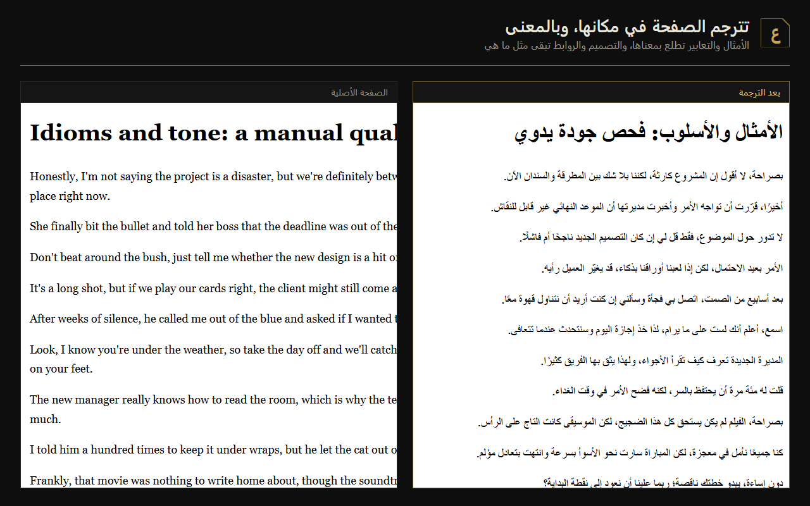
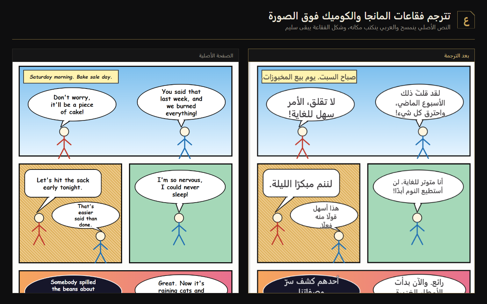

# معنى (Maana)

إضافة للمتصفح تكتب الترجمة داخل فقاعات المانجا والكوميك وتترجم الصفحة في مكانها، ترجمة بالمعنى وليست كلمة بكلمة. تترجم من أي لغة إلى العربية أو إلى أي لغة تختارها، وتعمل بمفتاحك الخاص من مزوّد الذكاء الاصطناعي الذي تختاره.

**[صفحة التحميل](https://yousf612-alwazzan.github.io/maana-translate/)** · **[حمّل المثبّت مباشرة](https://github.com/yousf612-alwazzan/maana-translate/releases/latest/download/Maana-Setup.exe)** · [English](#english)





---

**1. ماذا تفعل الإضافة؟**

1. تترجم نص الصفحة داخل مكانه: التصميم والروابط والصور تبقى كما هي.
2. تترجم فقاعات المانجا والكوميك: تمسح النص الأصلي وتكتب العربي مكانه.
3. الأمثال والتعابير تُترجم بمعناها.
4. تترجم من أي لغة. اللغة التي تترجم إليها تختارها من قائمة «ترجم إلى» (العربية افتراضياً، وفيها أكثر من ثلاثين لغة، أو تكتب اسم أي لغة).
5. تبدأ بالجزء الظاهر على الشاشة، والباقي يُترجم كلما نزلت في الصفحة.
6. ضغطة ثانية ترجع الصفحة الأصلية.

---

**2. التثبيت بالمثبّت (الأسهل)**

1. حمّل [Maana-Setup.exe](https://github.com/yousf612-alwazzan/maana-translate/releases/latest/download/Maana-Setup.exe) وشغّله. إذا طلعت رسالة حماية من ويندوز اضغط **More info** ثم **Run anyway** (الملف غير موقّع).
2. اختر متصفحك واضغط **ابدأ التثبيت**. البرنامج ينسخ الملفات لمكانها الدائم.
3. اتبع الخطوات الثلاث التي يعرضها داخل المتصفح: الصق العنوان، شغّل وضع المطوّر، ثم Load unpacked والصق المسار واضغط Select Folder.
   إذا رأيت داخل المجلد ثلاثة مجلدات (`_locales` و `icons` و `src`) فأنت في المكان الصحيح: لا تفتح أياً منها، اضغط Select Folder فقط.
4. البرنامج يجهّز لك العنوان والمسار للصق، فلا تكتب شيئاً بيدك.

المتصفح لا يسمح لأي برنامج أن يضيف إضافة بنفسه، ولذلك هذه الخطوات الثلاث يدوية.

---

**3. التثبيت اليدوي من ملف ZIP**

1. حمّل [maana-translate.zip](https://github.com/yousf612-alwazzan/maana-translate/releases/latest/download/maana-translate.zip) وفك ضغطه إلى مجلد دائم.
2. افتح الرابط `chrome://extensions` في المتصفح.
3. فعّل خيار **وضع المطور** (Developer mode) من الزاوية العلوية.
4. اضغط **تحميل غير المضغوطة** (Load unpacked) واختر المجلد الذي فككته نفسه: المجلد الذي ترى بداخله `_locales` و `icons` و `src`. لا تدخل أياً من هذه الثلاثة، قف عند المجلد الذي يحتويها واضغط Select Folder.
5. نفس الخطوات تنطبق على Edge و Brave.

---

**4. الإعداد الأول**

1. صفحة الإعدادات تفتح تلقائياً بعد التثبيت. اضغط **موافق** على رسالة البداية.
2. اضغط **اربط حساب OpenRouter**. يفتح موقع OpenRouter: سجّل دخول أو أنشئ حساباً واضغط موافق. ترجع لصفحة الإعدادات والمفتاح محفوظ تلقائياً.
3. اضغط **التفاصيل** عند OpenRouter ثم **اختبار** للتأكد أنه يعمل. النماذج التي لا تحتاج رصيداً لها 50 طلباً في اليوم.
4. تقدر تضيف مزوّدين آخرين بلصق مفتاحهم (Google Gemini، Groq، Claude، OpenAI، أو Ollama على جهازك). عند بلوغ حد مزوّد تنتقل الإضافة للذي بعده تلقائياً.

---

**5. الاستخدام اليومي**

1. اضغط على أيقونة الإضافة ثم **ترجم الصفحة** أو **ترجم الصور**.
2. الاختصارات: `Alt+T` للصفحة، و `Alt+M` لصور المانجا.
3. اضغط الأمر نفسه مرة ثانية لإرجاع الأصل.

---

**6. التحديث**

1. من صفحة الإعدادات اضغط **افحص التحديث**.
2. إذا وُجد إصدار جديد، حمّل المثبّت الجديد وشغّله.
3. افتح صفحة الإضافات واضغط زر **إعادة التحميل** (Reload) على بطاقة الإضافة.

---

**7. الخصوصية**

1. الإضافة لا تجمع أي بيانات، وليس لها خادم ولا إحصائيات.
2. النص أو الصورة التي تطلب ترجمتها تُرسل من متصفحك مباشرة إلى المزوّد الذي اخترته، وبعد موافقتك.
3. المفاتيح والإعدادات تبقى على جهازك.
4. بعض المزوّدين قد يستخدمون النصوص لتحسين نماذجهم، فاستخدم Ollama المحلي للصفحات الحساسة.
5. [سياسة الخصوصية كاملة](https://yousf612-alwazzan.github.io/maana-privacy/).

---

**8. ملاحظات**

1. قد يظهر لك المتصفح تحذيراً عن وضع المطور عند بدء التشغيل. هذا طبيعي.
2. مزوّد Ollama المحلي يرفض الإضافات إلا إذا سمحت له: شغّل الأمر `setx OLLAMA_ORIGINS "chrome-extension://*"` مرة واحدة ثم أعد تشغيل Ollama.
3. في المانجا: النص المرسوم فوق الرسمة نفسها (مثل المؤثرات الصوتية) يبقى كما هو وتظهر ترجمته بخط صغير بجانبه.
4. الإضافة مستقلة وغير تابعة لأي من الشركات المذكورة.

---

## English

Maana is a browser extension (Chrome, Edge, Brave and other Chromium browsers) that writes the translation inside manga and comic speech bubbles and translates web pages in place, by meaning rather than word for word. It translates from any language into Arabic or any other language you pick (30+ in the list, or type a language name). It uses your own API key from the AI provider you choose: Google Gemini, Groq, OpenRouter, Claude, OpenAI, or a local model through Ollama. The interface is in Arabic.

**Install**

1. Download and run [Maana-Setup.exe](https://github.com/yousf612-alwazzan/maana-translate/releases/latest/download/Maana-Setup.exe). Windows shows a warning because the file is unsigned: choose More info, then Run anyway.
2. Follow its three steps in the browser: paste the address it copied for you, switch on Developer mode, press Load unpacked, paste the folder path and press Select Folder. If you see the folders `_locales`, `icons` and `src`, you are in the right place: do not open any of them, just press Select Folder.
3. In the settings page, agree to the notice, then press **Connect OpenRouter account** (اربط حساب OpenRouter), sign in on OpenRouter and approve: you come back with a key on your own account already in place (one-click OAuth with PKCE, no copying). Or paste a key from another provider such as Google Gemini.
4. `Alt+T` translates the page, `Alt+M` translates comic images; the same shortcut restores the original.

Chromium browsers do not let a program add an extension by itself, so those three steps are manual. A [ZIP](https://github.com/yousf612-alwazzan/maana-translate/releases/latest/download/maana-translate.zip) is available for loading the folder by hand.

**Privacy.** No server, no analytics. The text or image you ask to translate goes straight from your browser to the provider you configured, after you agree. Keys and settings stay on your device. [Full policy](https://yousf612-alwazzan.github.io/maana-privacy/).

**Repository layout**

| Folder | What it holds |
| --- | --- |
| `extension/` | The extension itself (Manifest V3, plain JavaScript, no build step) |
| `installer/` | Source of the small guided Windows installer (C#, WPF) |
| `dev/` | Test harness, mock provider server, build scripts |
| `docs/` | The download page |

**Develop**

```
cd dev
npm install
npx playwright-core install chromium
node make-fixtures.mjs
node run-test.mjs
node shot-ui.mjs
node lang-test.mjs
node lib-test.mjs
```

`run-test.mjs` drives the real extension in Chromium against a mock provider (`mock-server.mjs`), so no API key is needed. The scripts look for the Playwright Chromium under `%LOCALAPPDATA%\ms-playwright`. Packages are built with `dev\make-zip.ps1` and `dev\build-installer.ps1` (the installer compiles with the C# compiler that ships with Windows).

The comic pages used in the tests and screenshots are original drawings made for this project.
